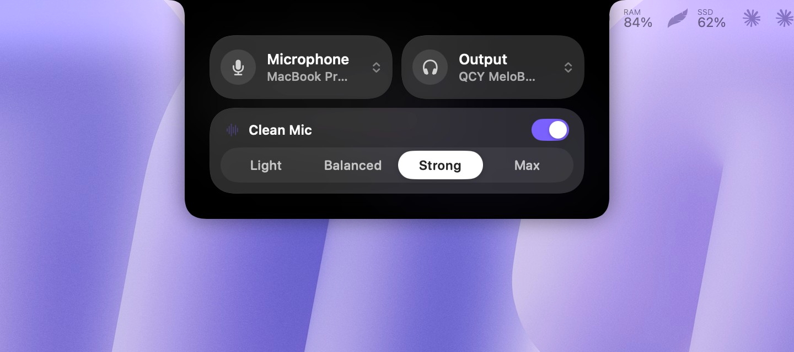
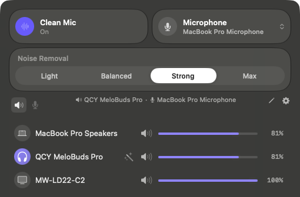
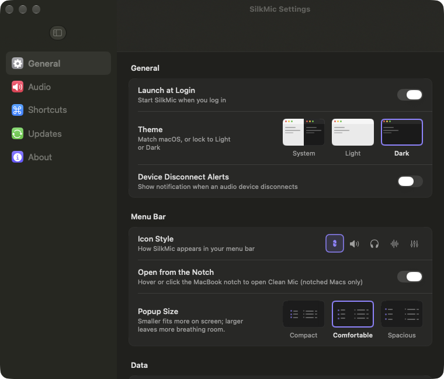

<p align="center">
  
</p>

<h1 align="center">SilkMic</h1>

<h3 align="center">Free AI noise cancellation and dictation for Mac</h3>

<p align="center">
  Clean voice in every app, one-click mic and speaker switching, per-app volume and hold-Fn dictation.<br>
  Free, open source and fully on-device. A free Krisp alternative for macOS.
</p>

<p align="center">
  <a href="https://github.com/delwerhossain/SilkMic/releases/latest"></a>
</p>

<p align="center">
  <a href="https://github.com/delwerhossain/SilkMic/releases/latest"></a>
  <a href="https://github.com/delwerhossain/SilkMic/releases"></a>
  
  
  <a href="LICENSE"></a>
</p>

<p align="center">
  
  <br><sub><b>Notch panel:</b> hover the notch to switch mic and speakers and set Clean Mic</sub>
</p>

<table align="center">
  <tr>
    <td align="center" width="50%">
      
      <br><sub><b>Menu bar:</b> Clean Mic, mic choice and device volume</sub>
    </td>
    <td align="center" width="50%">
      
      <br><sub><b>Settings:</b> native macOS, nothing new to learn</sub>
    </td>
  </tr>
</table>

## Why SilkMic

Your Mac's microphone hears everything: the fan, the keyboard, the street, the café. Apple's Voice Isolation works only in some apps, and Krisp limits its free plan and needs an account. SilkMic gives **every app** a clean microphone for free, and nothing you say leaves your Mac.

|  | SilkMic | Apple Voice Isolation | Krisp |
| --- | --- | --- | --- |
| Works in every app | Yes | Only apps that support it | Yes |
| Price | Free | Free | Limited free plan, then paid |
| Account needed | No | No | Yes |
| Open source | Yes | No | No |
| Hold-Fn dictation | Yes | No | No |

## Features

**Voice**
- **Clean Mic everywhere** - AI noise removal (DeepFilterNet3 on the Neural Engine) on a virtual microphone called "SilkMic". Works in Zoom, Google Meet, Microsoft Teams, Discord, Slack, WhatsApp, FaceTime, OBS, QuickTime and your browser.
- **Four levels** - Light, Balanced, Strong and Max, from natural voice to total silence between words.
- **Any microphone** - built-in MacBook mic, USB mics and Bluetooth earbuds such as AirPods. SilkMic remembers your pick and recovers by itself when Bluetooth switches to call mode.

**Control**
- **Notch panel** - hover the MacBook notch to switch microphone and speakers and control Clean Mic, on Liquid Glass.
- **Per-app volume mixer** - volume, mute, EQ and output device for each app, from the menu bar.
- **Device alerts** - a notification when a mic or headphones connect or disconnect.

**Dictation**
- **Hold Fn, speak, let go** - your words are typed into any app, Wispr Flow style. English runs on Apple's on-device engine with no download.
- **Bangla (Bengali script)** - an optional on-device model you can add in Settings, so the app stays small for everyone else.

**Privacy**
- No account, no subscription, no cloud and no telemetry. Audio is processed on your Mac and never stored.
- **Microphone only while you use it.** SilkMic opens your real mic only while an app (Zoom, Meet, WhatsApp...) is using the SilkMic microphone, or while you hold Fn to dictate.
- **App audio only when you change it.** Apps left at 100 % volume, unmuted, on the system output and with a flat EQ play straight through macOS. SilkMic touches an app's audio only after you change its volume, output or EQ.

## Install

1. **Download** `SilkMic-x.y.z.dmg` from the [latest release](https://github.com/delwerhossain/SilkMic/releases/latest), open it and drag **SilkMic** to **Applications**.
2. **Open SilkMic.** SilkMic is free and not signed with a paid Apple Developer ID, so macOS blocks the first launch. Open **System Settings → Privacy & Security**, scroll down and click **Open Anyway**. You do this once.
3. **Install the microphone.** Click **Install** when SilkMic asks and enter your Mac password. Sound stops for a second.
4. **Allow microphone access** when macOS asks.

That's it. SilkMic sets itself as your Mac's microphone, so most apps use it right away. If an app still uses another mic, choose **SilkMic** in that app's audio settings.

For dictation, also allow Accessibility (so SilkMic can type for you) and set **System Settings → Keyboard → Press 🌐 key to → Do Nothing**.

### Requirements

- Mac with Apple Silicon (M1 or later)
- macOS 15.4 or later; dictation and Liquid Glass need macOS 26 Tahoe or later
- 40 MB of disk space (15 MB download), plus 539 MB if you add the Bangla model

## FAQ

<details>
<summary><b>Is SilkMic really free?</b></summary>

Yes. It is free and open source under GPL-3.0. There is no paid tier and no account.
</details>

<details>
<summary><b>Does my voice go to a server?</b></summary>

No. Noise removal and dictation run on your Mac. SilkMic does not send audio, text or usage data anywhere.
</details>

<details>
<summary><b>Why does macOS show SilkMic using the microphone or recording audio?</b></summary>

The orange microphone indicator appears while SilkMic cleans your mic for a call or dictation, and goes away when the call app closes the mic. The "system audio recording" indicator appears only while you have changed some app's volume, output or EQ (or turned on AutoEQ or loudness), because SilkMic then has to process that app's sound. Put every app back to its defaults and it goes away.
</details>

<details>
<summary><b>Why does macOS say SilkMic can't be opened?</b></summary>

Apps without a paid Apple Developer ID need one manual approval. Open **System Settings → Privacy & Security** and click **Open Anyway** next to the SilkMic message. You can check the download with the `.sha256` file on the release page.
</details>

<details>
<summary><b>Other people still hear noise. What should I check?</b></summary>

Make sure the call app's microphone is **SilkMic**, not "MacBook Pro Microphone", and that Clean Mic is on. Try **Strong** in loud rooms.
</details>

<details>
<summary><b>How do I uninstall SilkMic?</b></summary>

Quit SilkMic and delete it from Applications. Then remove the microphone driver in Terminal and restart your Mac:

```bash
sudo rm -rf /Library/Audio/Plug-Ins/HAL/SilkMicDriver.driver
```
</details>

## Build from source

You need Xcode 26 or later.

```bash
git clone https://github.com/delwerhossain/SilkMic.git
cd SilkMic
Driver/build-driver.sh && Driver/install-driver.sh   # virtual mic, asks for your password
scripts/dev-install.sh                               # builds, signs and opens SilkMic
```

`scripts/build-dmg.sh` builds the same DMG as a release. How SilkMic was designed: [product requirements](docs/PRD.md), [technical design](docs/TRD.md), [research](docs/RESEARCH.md), [naming](docs/NAMING.md), [design](docs/DESIGN.md) and [roadmap](docs/ROADMAP.md).

Bug reports, ideas and pull requests are welcome. See [`CONTRIBUTING.md`](CONTRIBUTING.md). If SilkMic helps you, a ⭐ helps other Mac users find it.

## Credits

SilkMic is made by [Delwer Hossain](https://github.com/delwerhossain). It is built on open-source work and keeps its licences:

- [FineTune](https://github.com/ronitsingh10/FineTune) by Ronit Singh: per-app audio engine (GPL-3.0). SilkMic started as a fork of FineTune.
- [NoNoise Mac](https://github.com/ivalsaraj/NoNoise-Mac) by ivalsaraj, based on MetalVoice by Ghostkwebb: virtual mic driver and DeepFilterNet3 pipeline (MIT).
- [DeepFilterNet](https://github.com/Rikorose/DeepFilterNet), [whisper.cpp](https://github.com/ggml-org/whisper.cpp), [DynamicNotchKit](https://github.com/MrKai77/DynamicNotchKit) and the other packages in [`NOTICE`](NOTICE).

## License

[GNU General Public License v3.0](LICENSE). Copyright (C) 2026 Delwer Hossain.
